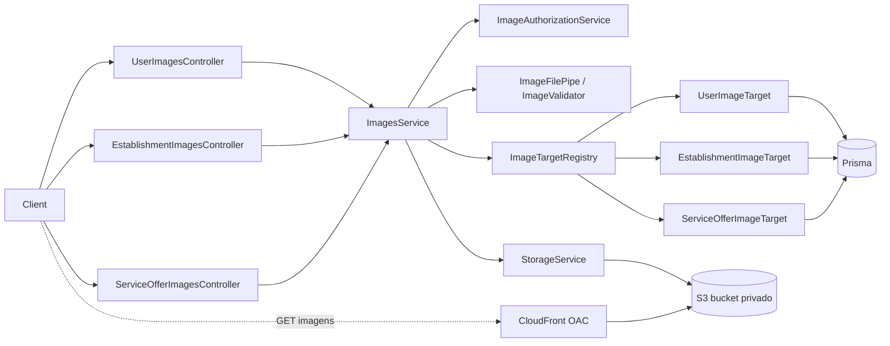

# Design Document: Suporte a Imagens (image-support)

## Overview

Adiciona CRUD completo de imagens para **User** (avatar, principal, galeria), **Establishment** (logo, principal, galeria) e **ServiceOffer** (principal, galeria) em `apps/api` (NestJS 11 + Prisma + Postgres), usando AWS S3 privado + CloudFront (OAC).

Decisões de design (alinhadas aos requisitos e às "Decisões em aberto"):

- **Upload multipart** com `multer` em memória (`FileInterceptor`/`FilesInterceptor` de `@nestjs/platform-express`). Sem presigned URL no MVP.
- **URL completa do CDN** persistida nos campos existentes (`avatarUrl`, `logoUrl`, `mainImageUrl`, `imageUrls`).
- **Dois módulos novos**, seguindo a estrutura `controllers/services/repositories/dto` do projeto:
  - `StorageModule`: infraestrutura S3 (sem conhecimento de domínio).
  - `ImagesModule`: regras de negócio, autorização e endpoints.
- **Strategy por entidade** (`ImageTarget`) para que adicionar uma nova entidade com imagens não altere o `ImagesService` (OCP/DIP).
- **Sem novas dependências**: validação de magic bytes é implementada localmente (JPEG, PNG, WebP) e o `S3Client` é injetado por token, permitindo mock em `jest` sem `aws-sdk-client-mock`.

## Contexto verificado no código

- Identificador público é o `slug` UUID (`ParseUUIDPipe`); `CurrentUser('id')` devolve o **id numérico** interno. O `JwtStrategy` devolve `{ id, email, roles }`, onde `roles` são os `slug` das roles do usuário; o projeto usa `@Roles('admin')`.
- `DatabaseModule` é `@Global`, então `PrismaService` pode ser injetado sem importar o módulo.
- `HttpExceptionFilter` e `TransformInterceptor` são globais (`APP_FILTER`/`APP_INTERCEPTOR`). Toda resposta de sucesso sai como `{ data, statusCode, timestamp }`.
- `ConfigModule.forRoot({ isGlobal: true })` já existe; `joi` **não** está instalado, então a validação das variáveis de storage é feita na factory do módulo.
- Colunas `avatarUrl` (users) e `logoUrl` (establishments) já existem na migration `20260303221039_create_database_v1`. **Faltam** `mainImageUrl` e `imageUrls` nas 3 tabelas.
- `UpdateUserDto`/`UpdateEstablishmentDto`/`Create*Dto` aceitam `avatarUrl`/`logoUrl` como string livre. Isso permite gravar uma URL arbitrária sem passar pelo storage (ver "Segurança").
- Os endpoints atuais `PATCH`/`DELETE` de users, establishments e service-offers **não verificam posse** (somente JWT). Os endpoints de imagem novos terão verificação de posse; corrigir os existentes está fora do escopo e registrado como risco.

## Architecture



Fluxo de escrita (upload/replace): validar arquivo -> resolver alvo e autorizar -> verificar limites -> `StorageService.upload` -> persistir no banco (transação) -> remover objeto antigo (best effort). Se a persistência falhar, o objeto recém-enviado é removido (R8.2).

Fluxo de remoção: atualizar banco primeiro -> remover objeto do S3 (best effort, falha só gera log). Assim nunca existe URL no banco apontando para objeto já apagado.

## Estrutura de arquivos

```
apps/api/src/modules/
├── storage/
│   ├── storage.module.ts
│   ├── storage.config.ts            # leitura/validação das envs
│   ├── storage.constants.ts         # tokens S3_CLIENT, STORAGE_CONFIG
│   ├── storage.exception.ts         # StorageException -> 502
│   ├── services/storage.service.ts
│   └── services/storage.service.spec.ts
└── images/
    ├── images.module.ts
    ├── image.constants.ts           # MIME, limites, assinaturas, ImageEntityType, ImageSlot
    ├── controllers/
    │   ├── user-images.controller.ts
    │   ├── establishment-images.controller.ts
    │   └── service-offer-images.controller.ts
    ├── services/
    │   ├── images.service.ts
    │   ├── image-authorization.service.ts
    │   └── image-cleanup.service.ts
    ├── targets/
    │   ├── image-target.interface.ts
    │   ├── image-target.registry.ts
    │   ├── user-image.target.ts
    │   ├── establishment-image.target.ts
    │   └── service-offer-image.target.ts
    ├── pipes/image-file.pipe.ts     # tipo, magic bytes, vazio
    └── dto/
        ├── image-url.dto.ts         # { url }
        ├── reorder-gallery.dto.ts   # { urls: string[] }
        ├── image-set-response.dto.ts
        └── index.ts
```

`AppModule` passa a importar `StorageModule` e `ImagesModule`. `UsersModule`, `EstablishmentsModule` e `ServiceOffersModule` importam `ImagesModule` somente para usar `ImageCleanupService` (R8.1/R8.4). `ImagesModule` não importa esses módulos (acessa Prisma diretamente por meio dos targets), evitando dependência circular.

## Components and Interfaces

### Storage

```typescript
// storage.config.ts
export interface StorageConfig {
  region: string;
  bucket: string;
  cdnUrl: string;        // sem barra final
  accessKeyId: string;
  secretAccessKey: string;
}
```

`StorageModule` registra:

- `STORAGE_CONFIG`: factory com `ConfigService` que lê `AWS_REGION`, `AWS_S3_BUCKET`, `AWS_CDN_URL`, `AWS_ACCESS_KEY_ID`, `AWS_SECRET_ACCESS_KEY`. Se faltar alguma, lança `Error('Variável de ambiente ausente: <NOME>')` na inicialização (R1.6). Remove a barra final de `AWS_CDN_URL`.
- `S3_CLIENT`: factory que cria `new S3Client({ region, credentials })`.
- `StorageService`, exportado.

```typescript
@Injectable()
export class StorageService {
  constructor(
    @Inject(S3_CLIENT) private readonly s3: S3Client,
    @Inject(STORAGE_CONFIG) private readonly config: StorageConfig,
  ) {}

  buildKey(entity: ImageEntityType, slug: string, role: ImageSlot, ext: string): string;
  /** PutObject; retorna { key, url }. */
  upload(params: { key: string; body: Buffer; contentType: string }): Promise<{ key: string; url: string }>;
  /** DeleteObject a partir da URL pública. Retorna false se a URL não for do CDN. */
  deleteByUrl(url: string): Promise<boolean>;
  deleteManyByUrl(urls: string[]): Promise<{ failed: string[] }>;
  toUrl(key: string): string;        // `${cdnUrl}/${key}` (R1.4)
  toKey(url: string): string | null; // remove prefixo `${cdnUrl}/` (R1.5)
}
```

Regras:

- `buildKey` gera `{entidade}/{slug}/{papel}/{uuid}.{ext}` com `crypto.randomUUID()`. A extensão vem do MIME **detectado**, nunca do nome enviado.
- `upload` define `ContentType` e `CacheControl: 'public, max-age=31536000, immutable'` (a chave é única por upload, então o cache longo é seguro).
- `toKey` devolve `null` se a URL não começa com `${cdnUrl}/`. `deleteByUrl` ignora (log + `false`) URLs fora do CDN, impedindo que um valor adulterado no banco apague objetos arbitrários.
- Falhas do SDK são capturadas, logadas (`Logger`) e relançadas como `StorageException extends BadGatewayException` (R1.7).

### Validação de arquivos (`ImageFilePipe`)

`PipeTransform` aplicado ao `@UploadedFile()`/`@UploadedFiles()`:

1. Ausência de arquivo -> `BadRequestException` (400) (R2.4).
2. `mimetype` fora de `image/jpeg|image/png|image/webp` -> `UnsupportedMediaTypeException` (415) citando os tipos aceitos (R2.1/R2.2).
3. Magic bytes divergentes do MIME declarado -> 415 (R2.6). Assinaturas: JPEG `FF D8 FF`; PNG `89 50 4E 47 0D 0A 1A 0A`; WebP `RIFF....WEBP`.
4. Retorna `ValidatedImage { buffer, mimeType, ext, size }`.

O limite de tamanho fica no `multer` (`limits.fileSize = 5 MB`, `limits.files = 10`). O Nest converte `LIMIT_FILE_SIZE` em `PayloadTooLargeException` (413) e `LIMIT_UNEXPECTED_FILE` em 400 (R2.3). Isso corta o upload antes de carregar tudo em memória.

Constantes em `image.constants.ts`:

```typescript
export const ALLOWED_IMAGE_MIME = ['image/jpeg', 'image/png', 'image/webp'] as const;
export const MAX_IMAGE_FILE_SIZE = 5 * 1024 * 1024;
export const MAX_GALLERY_SIZE: Record<ImageEntityType, number> = {
  user: 10, establishment: 20, 'service-offer': 10,
};
export type ImageEntityType = 'user' | 'establishment' | 'service-offer';
export type ImageSlot = 'avatar' | 'logo' | 'main' | 'gallery';
```

### Image targets (Strategy)

```typescript
export interface ImageTarget {
  readonly entity: ImageEntityType;
  /** Campo "profile" próprio da entidade: avatarUrl (user), logoUrl (establishment), null (service-offer). */
  readonly profileField: 'avatarUrl' | 'logoUrl' | null;
  readonly profileSlot: 'avatar' | 'logo' | null;
  /** Carrega a entidade por slug (404 se não existir) com o dono para autorização. */
  load(slug: string): Promise<ImageTargetRecord>;
  update(slug: string, data: ImageFieldsPatch, tx?: Prisma.TransactionClient): Promise<ImageTargetRecord>;
  /** Para limpeza ao excluir (inclui filhos, ex.: ofertas do estabelecimento). */
  collectUrls(slug: string): Promise<string[]>;
}

export interface ImageTargetRecord {
  id: number;
  slug: string;
  ownerUserId: number;               // user.id | establishment.ownerId | offer.establishment.ownerId
  profileUrl: string | null;
  mainImageUrl: string | null;
  imageUrls: string[];
}
```

`ImageTargetRegistry` recebe os três targets por DI e expõe `get(entity)`. Cada target usa o delegate Prisma correspondente (`user`, `establishment`, `serviceOffer`) com `where: { slug }`. `ServiceOfferImageTarget.load` faz `include: { establishment: { select: { ownerId: true } } }`.

### ImageAuthorizationService

```typescript
assertCanWrite(record: ImageTargetRecord, current: { id: number; roles: string[] }): void
```

Permite se `record.ownerUserId === current.id` ou `current.roles.includes('admin')`; caso contrário `ForbiddenException` (403) (R7.3/R7.5). O 401 vem do `JwtAuthGuard` (R7.4). Leitura (`GET`) é `@Public()` (R7.1).

### ImagesService

```typescript
setSingle(entity, slug, slot: 'avatar'|'logo'|'main', file: ValidatedImage, user): Promise<ImageSetResponse>;
removeSingle(entity, slug, slot, user): Promise<ImageSetResponse>;
addToGallery(entity, slug, files: ValidatedImage[], user): Promise<ImageSetResponse>;
removeFromGallery(entity, slug, url, user): Promise<ImageSetResponse>;
promoteToMain(entity, slug, url, user): Promise<ImageSetResponse>;
reorderGallery(entity, slug, urls, user): Promise<ImageSetResponse>;
list(entity, slug): Promise<ImageSetResponse>;
```

Comportamento:

- **setSingle**: carrega o alvo, autoriza, valida que `slot` existe para a entidade (ex.: `avatar` em service-offer -> 404 de rota), faz upload, atualiza o campo. Se havia URL anterior, remove o objeto antigo depois do commit; falha nessa remoção só gera log da Object_Key órfã (R6.1, R8.3). Falha no `update` remove o novo objeto (R8.2).
- **addToGallery**: verifica `imageUrls.length + files.length <= MAX_GALLERY_SIZE[entity]` **antes** de qualquer upload (422, nada gravado, R2.5). Faz upload de todos; se algum falhar, remove os já enviados e propaga 502. Persiste dentro de `prisma.$transaction` relendo `imageUrls` e revalidando o limite (evita corrida entre requisições concorrentes) e concatenando ao final (R3.3).
- **removeFromGallery**: se a URL não está em `imageUrls` -> 404 (R3.7). Remove a URL do array no banco, depois apaga o objeto. Se a URL removida era a `mainImageUrl`, o campo principal não é alterado (a principal é independente da galeria; ver abaixo).
- **promoteToMain**: a URL deve estar em `imageUrls`, senão 404 (R6.3). Atualiza `mainImageUrl` para a URL escolhida. A galeria **mantém** a URL (a imagem principal passa a apontar para o mesmo objeto). Para evitar apagar um objeto ainda referenciado, `removeSingle('main')` e `setSingle('main')` só apagam o objeto antigo se a URL antiga **não** estiver em `imageUrls`; do mesmo modo `removeFromGallery` só apaga o objeto se a URL não for igual a `mainImageUrl`.
- **reorderGallery**: compara como conjuntos (mesmo tamanho, sem duplicatas, mesmos elementos); divergência -> 400 sem alterar nada (R6.4/R6.5).
- **list**: retorna `{ profileUrl, mainImageUrl, imageUrls }` já com URLs do CDN.

Tipo de resposta, com a chave de perfil nomeada conforme a entidade:

```typescript
export class ImageSetResponseDto {
  avatarUrl?: string | null;   // user
  logoUrl?: string | null;     // establishment
  mainImageUrl: string | null;
  imageUrls: string[];
}
```

### ImageCleanupService

```typescript
/** Coleta URLs antes da exclusão e remove os objetos depois, best effort. */
collect(entity: ImageEntityType, slug: string): Promise<string[]>;
purge(urls: string[]): Promise<void>;   // loga Object_Keys que falharam
```

`UserService.remove`, `EstablishmentService.remove` e `ServiceOfferService.remove` passam a: `const urls = await cleanup.collect(...)` -> excluir registro -> `await cleanup.purge(urls)`. `EstablishmentImageTarget.collectUrls` inclui as imagens das `serviceOffers` do estabelecimento (R8.4). Falha de S3 nunca impede a exclusão (R8.3).

## API Endpoints

Todas as rotas ficam sob o prefixo global `/api`. Todas as de escrita usam `@UseGuards(JwtAuthGuard, RolesGuard)`, `@ApiBearerAuth()` e `@ApiConsumes('multipart/form-data')` quando recebem arquivo. Controllers finos, uma classe por entidade, delegando para `ImagesService`.

| Método | Rota | Corpo | Acesso | Ação |
|---|---|---|---|---|
| GET | `/users/:slug/images` | - | público | Lista imagens |
| PUT | `/users/:slug/images/avatar` | multipart `file` | dono/admin | Define/substitui avatar |
| DELETE | `/users/:slug/images/avatar` | - | dono/admin | Remove avatar |
| PUT | `/users/:slug/images/main` | multipart `file` | dono/admin | Define/substitui principal |
| DELETE | `/users/:slug/images/main` | - | dono/admin | Remove principal |
| PATCH | `/users/:slug/images/main` | `{ url }` | dono/admin | Promove imagem da galeria |
| POST | `/users/:slug/images/gallery` | multipart `files[]` | dono/admin | Adiciona à galeria |
| DELETE | `/users/:slug/images/gallery` | `{ url }` | dono/admin | Remove da galeria |
| PUT | `/users/:slug/images/gallery/order` | `{ urls }` | dono/admin | Reordena galeria |

O mesmo conjunto vale para `establishments/:slug/images` (com `logo` no lugar de `avatar`) e `service-offers/:slug/images` (sem rota de perfil `avatar`/`logo`).

Observações:

- `:slug` usa `ParseUUIDPipe`, igual aos controllers atuais.
- `DELETE` com corpo é aceito pelo Express/Nest, mas alguns clientes o descartam; por isso a remoção da galeria também aceita `?url=` via `@Query`. O DTO `ImageUrlDto` valida `@IsUrl` e `@IsString`.
- Rotas literais (`gallery/order`) são declaradas antes de rotas parametrizadas para não haver captura indevida.
- `FileInterceptor('file', multerOptions)` e `FilesInterceptor('files', 10, multerOptions)` com `memoryStorage()` e os limites acima.
- Respostas passam pelo `TransformInterceptor`: `{ data: ImageSetResponseDto, statusCode, timestamp }`. Upload retorna 200 (PUT/PATCH) ou 201 (POST).

### Mapeamento de erros

| Situação | Status | Origem |
|---|---|---|
| Sem arquivo / ordem inválida / campo inesperado | 400 | `ImageFilePipe`, `ImagesService`, multer |
| Sem JWT | 401 | `JwtAuthGuard` |
| Não é dono nem admin | 403 | `ImageAuthorizationService` |
| Entidade ou URL inexistente | 404 | `ImageTarget.load`, `ImagesService` |
| Tamanho excedido | 413 | multer -> Nest |
| MIME inválido / magic bytes divergentes | 415 | `ImageFilePipe` |
| Galeria excede o limite | 422 | `ImagesService` |
| Falha no S3 | 502 | `StorageException` |

## Data Models

### Schema Prisma

Para que o `ADD COLUMN` preencha os registros existentes com array vazio (R9.2), os campos de galeria recebem `@default([])`:

```prisma
imageUrls    String[] @default([])
```

nos modelos `User`, `Establishment` e `ServiceOffer`. `mainImageUrl String? @db.Text` já está declarado.

### Migration

Nova migration `add_image_fields` (gerada por `prisma migrate dev --name add_image_fields`), equivalente a:

```sql
ALTER TABLE "users"           ADD COLUMN "mainImageUrl" TEXT, ADD COLUMN "imageUrls" TEXT[] DEFAULT ARRAY[]::TEXT[];
ALTER TABLE "establishments"  ADD COLUMN "mainImageUrl" TEXT, ADD COLUMN "imageUrls" TEXT[] DEFAULT ARRAY[]::TEXT[];
ALTER TABLE "service_offers"  ADD COLUMN "mainImageUrl" TEXT, ADD COLUMN "imageUrls" TEXT[] DEFAULT ARRAY[]::TEXT[];
```

`avatarUrl` e `logoUrl` já existem na migration v1, então não são recriadas. O client é regenerado em `apps/api/src/generated` e commitado junto.

Ponto de atenção: a migration `20260306000047` converte as chaves de UUID para `SERIAL`. Ao rodar `migrate dev` é preciso confirmar que o shadow database aplica todo o histórico sem *drift*; se houver, o problema é tratado antes de criar a nova migration.

## Segurança

- **Bucket privado** e leitura somente via CloudFront (OAC); nenhuma ACL por objeto (R7.6).
- **Escrita de URLs só pelo módulo de imagens**: `avatarUrl` e `logoUrl` serão removidos de `CreateUserDto`, `UpdateUserDto`, `CreateEstablishmentDto` e `UpdateEstablishmentDto`; com `whitelist` + `forbidNonWhitelisted` no `main.ts`, o envio desses campos passa a retornar 400. Antes de remover, é preciso buscar usos no `apps/web` e em `apps/api-e2e`, pois é uma mudança de contrato. Sem isso, qualquer usuário poderia gravar uma URL arbitrária e, depois, fazer o módulo de imagens apagar objeto fora do escopo; o `StorageService.toKey` com checagem de prefixo é a segunda barreira.
- **Content-Type e extensão** derivados dos magic bytes, nunca do nome do arquivo (evita `.html`/`.svg` servidos pelo CDN). SVG não é aceito.
- **Chave de objeto** contém apenas `entidade`, `slug` UUID e UUID gerado no servidor; nenhum dado do cliente entra no caminho.
- **Credenciais** só por variáveis de ambiente; `.env.example` traz valores fictícios. Nenhum segredo em log.
- **Throttler** global já protege os endpoints; uploads usam o mesmo limite.
- **Risco registrado**: os `PATCH`/`DELETE` existentes das três entidades não verificam posse. Fora do escopo desta feature.

## Configuração e infraestrutura

- `apps/api/.env.example`: adicionar `AWS_REGION`, `AWS_S3_BUCKET`, `AWS_CDN_URL`, `AWS_ACCESS_KEY_ID`, `AWS_SECRET_ACCESS_KEY` com valores fictícios (R10.1).
- `infra/src/backend.ts`: injetar `AWS_REGION` (a partir de `aws.getRegionOutput().name`) junto das variáveis já injetadas (R10.2). Passar a chave via `pulumi.secret` não é necessário aqui, mas fica registrado como melhoria.
- `pnpm-workspace.yaml`: substituir cada placeholder `set this to true or false` por `true`/`false` explícito (necessários para build: `@nestjs/core`, `@prisma/engines`, `prisma`, `argon2`, `@swc/core`, `nx`, `sharp`, `unrs-resolver`, `@parcel/watcher`; os demais `false`), ou reverter o bloco autogerado (R10.4). A decisão final é tomada na tarefa, conferindo o que o build realmente exige.
- `package.json`: `@aws-sdk/s3-request-presigner` não será usado no MVP; manter ou remover é decidido na tarefa de limpeza (R10.5). `@types/multer` e `multer` ficam.
- Documentação: ajustar a menção a Supabase para AWS S3 + CloudFront em `.specs/codebase/INTEGRATIONS.md` e `STACK.md`, se existir (R10.6).

## Error Handling

- `StorageService` nunca devolve erros do SDK crus: loga com contexto (`key`, operação) e lança `StorageException` (502).
- Remoções "best effort" (`purge`, substituição, remoção) usam `Promise.allSettled`, logam cada `Object_Key` órfã com `Logger.warn` e não alteram o resultado HTTP (R8.3).
- Em `addToGallery`, falha parcial executa compensação: apaga os objetos já enviados antes de relançar.
- Falha em `$transaction` após upload aciona compensação (apaga o(s) objeto(s) novo(s)).

## Testing Strategy

Framework: Jest + `@nestjs/testing` (já configurados em `apps/api`). `S3_CLIENT` e os repositórios/targets são substituídos por mocks via DI.

| Alvo | Cobertura (referência) |
|---|---|
| `StorageService` | `buildKey` (formato e extensão), `upload` (Bucket, Key, ContentType, CacheControl), `toUrl`/`toKey` (barra final, URL fora do CDN), `deleteByUrl`, falha do SDK -> `StorageException` (R11.1) |
| `storage.config` | variável ausente derruba a inicialização com o nome da variável (R1.6) |
| `ImageFilePipe` | arquivo ausente, MIME inválido, assinatura divergente, cada formato válido (R11.2) |
| `ImagesService` | upload/replace com limpeza do antigo, limite da galeria (nada gravado), compensação em falha de DB, promoção, remoção, reordenação válida/ inválida, objeto compartilhado entre principal e galeria não é apagado (R11.3) |
| `ImageAuthorizationService` | dono, admin, terceiro (403) |
| Controllers | 401 sem token, 403 terceiro, 404 slug inexistente, 413/415 (R11.4) |
| `ImageCleanupService` | coleta inclui ofertas do estabelecimento; falha de S3 não propaga |

Testes de propriedade (opcionais, `fast-check` não está instalado, então ficam como testes parametrizados):

- Para qualquer sequência de adições, remoções e reordenações, `imageUrls` nunca tem duplicatas nem excede o máximo.
- `reorderGallery(urls)` preserva o conjunto de URLs.
- `toKey(toUrl(k)) === k` para qualquer chave gerada por `buildKey`.

## Correctness Properties

### Property 1: Consistência banco x bucket

**Validates: Requirements 3.5, 3.6, 8.2, 8.3**

Toda URL do CDN presente em `mainImageUrl`, `avatarUrl`, `logoUrl` ou `imageUrls` corresponde a um objeto existente no bucket, exceto durante a janela entre persistir e remover (a remoção só ocorre depois do commit).

### Property 2: Objeto referenciado nunca é apagado

**Validates: Requirements 6.1, 6.2, 8.3**

Um objeto só é removido do S3 quando nenhum campo da entidade ainda o referencia.

### Property 3: Limite da galeria

**Validates: Requirements 2.5, 3.3**

`imageUrls.length <= MAX_GALLERY_SIZE[entity]` após qualquer operação, inclusive sob concorrência (revalidação dentro da transação).

### Property 4: Autorização

**Validates: Requirements 7.2, 7.3, 7.5**

Nenhuma escrita é aplicada sem que `ownerUserId === current.id` ou `roles` contenha `admin`.

### Property 5: Escopo de remoção

**Validates: Requirements 1.4, 1.5**

`deleteByUrl` só remove chaves cujo prefixo é `${AWS_CDN_URL}/`, e `toKey(toUrl(k)) === k` para qualquer chave gerada por `buildKey`.

### Property 6: Reordenação preserva o conjunto

**Validates: Requirements 6.4, 6.5**

`reorderGallery(urls)` só é aplicada se `urls` for uma permutação exata de `imageUrls`; caso contrário o estado permanece inalterado.